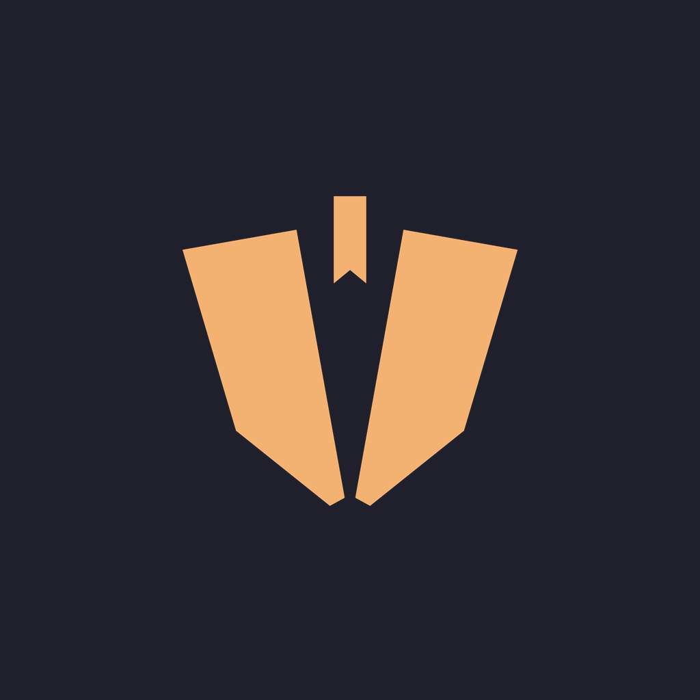
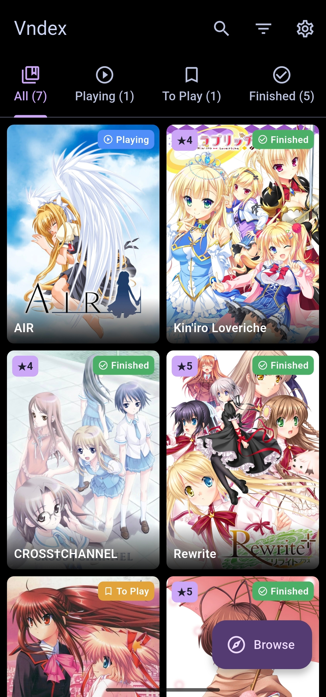
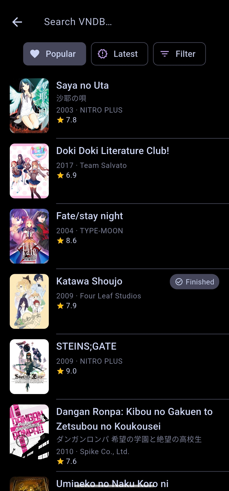
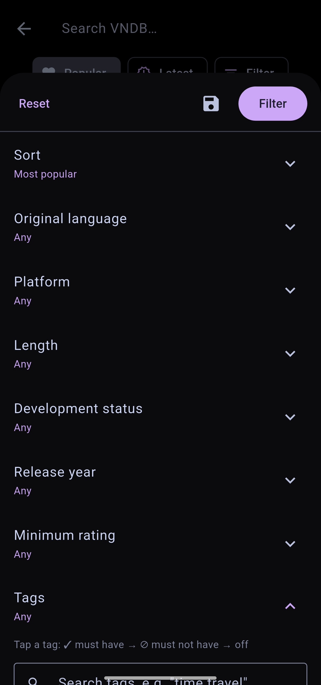
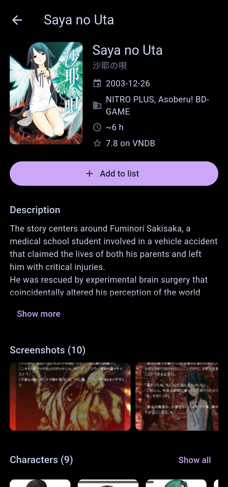

<p align="center">
  
</p>

<h1 align="center">Vndex</h1>

<p align="center">
  A personal visual novel tracker and backlog manager for Android, powered by <a href="https://vndb.org">VNDB</a>.
</p>

<p align="center">
  <a href="../../releases/latest"><b>⬇ Download the latest APK</b></a>
</p>

---

## About

Vndex keeps track of the visual novels you're playing, want to play, have finished, or dropped. It looks everything up on VNDB (titles, covers, descriptions, tags, screenshots and characters), while **your lists, ratings and reviews stay on your device**. No account needed.

## Features

**Your library**
- Four lists: **Playing**, **To Play**, **Finished**, **Dropped**, plus an **All** tab with a colored badge showing which list each VN is in
- **5-star ratings** with half stars, and written **reviews** with a spoiler toggle
- Started and finished dates recorded automatically
- Search your lists, and **filter / sort / display** options: compact, comfortable or cover-only grids, or a list, with 2–6 items per row
- Works offline for VNs in your lists

**Discover**
- **Browse** VNDB with **Popular** and **Latest** presets
- A full **filter sheet**: sort, original language, platform, length, development status, release year, minimum rating, and tags you can **include or exclude**
- **Saved searches**
- Tap any tag to see VNs with it, or use **Find similar** to match a VN's top tags

**VN pages**
- Cover, release date, developers, length and VNDB rating
- Description with spoilers removed
- **Screenshots** (swipe and pinch to zoom) and **characters**, with spoiler characters hidden

**Settings**
- Light / dark / system themes: **Vndex**, **Dusk** and **Catppuccin**, plus a pure black mode
- **18+ options**: blur sensitive covers and images, and show or hide sexual content tags
- Date format, data management, and open source licenses

## Screenshots

| Library | Browse |
|:---:|:---:|
|  |  |

| Filter | VN page |
|:---:|:---:|
|  |  |

## Install

1. Download `Vndex-v1.0.0.apk` from the [latest release](../../releases/latest).
2. Open it on your Android phone. If asked, allow installing apps from your browser or file manager.
3. Requires Android 5.0 or newer.

## Build it yourself

You'll need the [Flutter SDK](https://docs.flutter.dev/get-started/install) (3.29 or newer) and the Android SDK.

```bash
git clone https://github.com/BrylleJacobGeslaga-UCM/Vndex.git
cd Vndex
flutter pub get
flutter run                 # on a connected phone or emulator
flutter run -d chrome       # in the browser, for quick testing
flutter build apk --release # build an installable APK
```

## Tech stack

| | |
|---|---|
| Framework | Flutter (Dart) |
| State management | Riverpod |
| Local storage | sembast (works on Android and web) |
| Data source | VNDB API v2 (Kana) |
| Images | cached_network_image |

## Project structure

```
lib/
├── core/          theme, constants, helpers, shared widgets
├── data/
│   ├── remote/    VNDB API calls
│   ├── local/     local database and settings storage
│   └── repository/  the single place screens get data from
├── models/        VN, entries, filters, settings
├── providers/     Riverpod providers
└── screens/       home, browse, detail, settings
```

## Credits

- VN data, covers, screenshots and character information come from [VNDB.org](https://vndb.org), the community visual novel database, through its public API.
- Vndex is an unofficial personal project and is not affiliated with or endorsed by VNDB.

## License

No license has been chosen yet, so all rights are reserved by the author.
